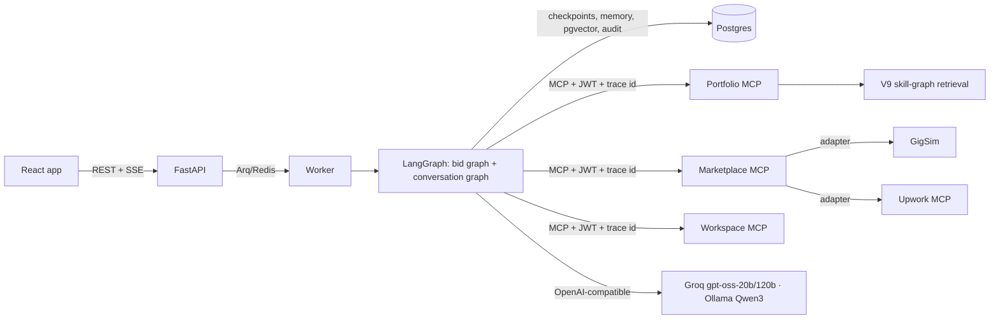

# GigBid — a multi-agent copilot that bids only where the freelancer can prove fit

<!-- demo GIF is added after the demo recording: docs/images/demo.gif -->

**Live:** https://gigbid-d3l2.onrender.com (reviewer login is in the private submission comment; the free instance
sleeps when idle, so the first load takes ~1 minute) · **Demo video:** _link added after recording_ ·
**Portfolio MCP server:** [`mcp_servers/portfolio`](mcp_servers/portfolio/README.md) ·
**Write-up:** _link added after publishing_ · **Report:** `docs/report/GigBid_RnD_Report.pdf`

GigBid reads a freelancer's job feed, decides which jobs to bid on from **evidence in their own portfolio**, drafts a
proposal whose every claim cites that evidence, and stops for a human to approve before anything is sent or any
Connects are spent. Client replies get the same treatment: intent → grounded reply → approval → send.

Everything runs against **GigSim**, a marketplace simulator we wrote (`gigsim/`, frozen by CI), with three synthetic
freelancer personas. The same marketplace port can point at the official Upwork MCP server (`MARKETPLACE_MODE=upwork_live`).

## What it does, in numbers

All numbers below come from files in [`evals/results/`](evals/results/); CI fails if a tagged number or a table in this
README stops matching those files.

* On 21 labelled dev jobs, the bid/skip decision reaches F1 **<!--n:decision_eval.json:summary.bid_f1-->0.8696**, every
  planted scam is skipped (scam recall **<!--n:decision_eval.json:summary.scam_recall-->1.0**), and the claim verifier
  cuts unsupported proposal claims from **<!--n:decision_eval.json:summary.unsupported_claim_rate_before-->0.25** to
  **<!--n:decision_eval.json:summary.unsupported_claim_rate_after-->0.0** before the critic sees a draft.
* The shipped retriever (V9, a skill graph with a hybrid fallback) finds gold evidence in the top 5 for
  **<!--n:rag_benchmark.json:summary.v9_skill_graph.overall.recall@5-->0.6717** of requirements, against
  **<!--n:rag_benchmark.json:summary.v0_naive.overall.recall@5-->0.4415** for naive dense RAG (247 jobs).
* The surprising result: a cross-encoder reranker made retrieval **worse** on this corpus (see the write-up and
  ADR 0003), and the decision threshold everyone would pick by hand (0.55) gave F1
  **<!--n:fit_calibration.json:summary.check_at_previous_default_0.55.f1-->0.4331** on held-out jobs; calibrated on a
  separate tune split it gives **<!--n:fit_calibration.json:summary.check.f1-->0.8104**.

## Architecture



* **Bid graph** ([diagram](docs/bid_graph.svg), rendered from code): `intake` → (`analyst` ∥ `risk` ∥ `matcher`, a
  `Send` fan-out) → deterministic `decide` → `pricing` → `writer` ⇄ `verifier` → `critic` (≤2 revisions) →
  `compliance` → `preview` (draft + dry-run) → **`approval` (interrupt)** → `submit` (same idempotency key).
* **Conversation graph** ([diagram](docs/conversation_graph.svg)): `intent` → `liaison` (grounded reply, rate floor,
  free slots) → `compliance` → **approval** → `send` (+ interview hold).
* Why each agent exists, the stores and the marketplace port: [docs/ARCHITECTURE.md](docs/ARCHITECTURE.md);
  decisions: [docs/adr/](docs/adr/); tools and their auth: [docs/TOOLS.md](docs/TOOLS.md).

What is never automated: sending a proposal or message, spending Connects, and accepting an interview. Those need an
approval token that only the human approval endpoint can mint; the marketplace MCP server rejects writes without one.

## Results

### Retrieval (B2) — 247 dev jobs, gold evidence per requirement

<!-- table:rag -->
| variant | Recall@5 | capped R@5 | MRR | nDCG@10 | p95 latency (s) | R@5 ai_ml | R@5 data | R@5 fullstack |
|---|---|---|---|---|---|---|---|---|
| v0_naive | 0.441 | 0.466 | 0.631 | 0.534 | 0.020 | 0.482 | 0.427 | 0.417 |
| v1_decomposition | 0.544 | 0.572 | 0.675 | 0.640 | 0.032 | 0.581 | 0.525 | 0.531 |
| v2_hybrid | 0.574 | 0.603 | 0.763 | 0.703 | 0.035 | 0.604 | 0.537 | 0.592 |
| v3_rerank | 0.513 | 0.540 | 0.734 | 0.659 | 2.215 | 0.525 | 0.485 | 0.540 |
| v4_outcome_aware | 0.487 | 0.515 | 0.712 | 0.629 | 2.239 | 0.502 | 0.465 | 0.500 |
| v5_multivector | 0.507 | 0.532 | 0.604 | 0.550 | 0.048 | 0.490 | 0.486 | 0.555 |
| v6_contextual | 0.549 | 0.575 | 0.758 | 0.704 | 0.038 | 0.562 | 0.514 | 0.581 |
| v8_self_rag | 0.446 | 0.473 | 0.618 | 0.515 | 3.886 | 0.413 | 0.471 | 0.449 |
| v9_skill_graph | 0.672 | 0.704 | 0.848 | 0.778 | 0.065 | 0.704 | 0.622 | 0.705 |

n = 247 dev jobs with gold evidence; commit ea06a77; embedder fastembed.
<!-- /table -->

### End-to-end (B5)

<!-- table:b5 -->
| variant | Evidence Recall@5 | nDCG@10 | unsupported claim rate (after verification) | judge score (1-10) | GigSim reply rate | p95 latency (s) | cost per job (USD) |
|---|---|---|---|---|---|---|---|
| V0 naive | 0.441 | 0.534 | pending | pending | pending | pending | pending |
| V9 skill graph (shipped) | 0.672 | 0.778 | pending | pending | pending | pending | pending |
<!-- /table -->

### Decisions

<!-- table:decisions -->
| run | n | bid F1 | accuracy | scam recall | false-scam rate | price in band | unsupported claims before -> after | p95 latency (s) | cost/job (USD) |
|---|---|---|---|---|---|---|---|---|---|
| first matcher, default thresholds | 21 | 0.286 | 0.524 | 1.000 | 0.050 | 1.000 | 0.400 -> 0.000 | 50.3 | 0.00137 |
| shipped (calibrated) | 21 | 0.870 | 0.857 | 1.000 | 0.000 | 0.727 | 0.250 -> 0.000 | 250.4 | 0.00125 |
| hidden test | pending |||||||||
<!-- /table -->

### Multi-agent comparison (C) — same jobs, same tools, same models

<!-- table:multiagent -->
_multiagent_comparison.json pending_
<!-- /table -->

### Tool granularity (A)

<!-- table:tools -->
_tool_granularity.json pending_
<!-- /table -->

### Prompt injection (E4)

<!-- table:injection -->
_injection_eval.json pending_
<!-- /table -->

Full tables (by persona, by job type, ablation) and how each runner works: [evals/README.md](evals/README.md).
Public traces (read-only pages on the live app, same trace id as the MCP audit log): _three links added after the demo run_.

## Run it yourself

Requirements: Docker, or Python 3.11/3.12 + Node 20 + Postgres 16 with pgvector. One free Groq key is enough.

```bash
git clone https://github.com/Talha-Qamar/Agentic-A2 && cd Agentic-A2
cp .env.example .env          # set GROQ_API_KEY; never commit .env
docker compose up --build     # app on http://localhost:8000, Phoenix traces on http://localhost:6006
```

Without Docker: `make setup && make stack` (GigSim + MCP servers), then `make api` and open http://localhost:8000.
Fully offline: `GIGBID_PROFILE=local docker compose --profile ollama up` (Qwen3 4B through Ollama).

Tests: `make test` (ruff, unit, MCP contract snapshot, graph integration, 7 Playwright tests).
Experiments: `make eval` runs every runner in `evals/runners/`; each writes JSON with provenance (git SHA, models,
host) to `evals/results/`. The data can be regenerated with `make data` (see [docs/DATA_CARD.md](docs/DATA_CARD.md)).

Install only the Portfolio MCP server (no clone needed):

```bash
uvx --from "git+https://github.com/Talha-Qamar/Agentic-A2#subdirectory=mcp_servers/portfolio" gigbid-portfolio-mcp
```

## Repository map

| path | what |
|---|---|
| `gigsim/` | marketplace simulator (clients, Connects, rate limits, faults, versioned policies) — frozen |
| `agent/` | graphs, nodes, prompts (`agent/prompts/*.md` only), memory, guardrails, config |
| `mcp_servers/` | portfolio (published), marketplace (GigSim + Upwork adapters), workspace |
| `rag/` | loaders (incl. GitHub MCP ingestion), chunkers, indexes, variants V0–V9, claim verification |
| `apps/api`, `apps/web` | FastAPI + SSE, React/Vite UI with generated TypeScript client |
| `worker/` | Arq tasks: scout, analyse, resume, converse, pipeline sync |
| `evals/` | datasets, runners, results (every number cited anywhere) |
| `docs/` | architecture, ADRs, data card, tools, runbook, extension (X3), AI usage |

## Pinned versions

Python 3.11/3.12 · langgraph 1.2.20 · langgraph-checkpoint-postgres 3.2.0 · langgraph-supervisor 0.0.31 ·
langchain-mcp-adapters 0.3.2 · mcp 1.30.0 · fastapi 0.162.4 · pydantic 2.14.3 · psycopg 3.3.8 · pgvector 0.4.1 ·
fastembed 0.9.1 (bge-small-en-v1.5, ms-marco-MiniLM-L-6-v2) · wordllama 0.4.0.post1 · React 18.3.1 · Vite 5.4.11 ·
Playwright 1.63.0 · Postgres 16 + pgvector · Redis 7. Full list: `requirements-eval.txt`, `apps/web/package.json`.

## Data and licences

Personas, portfolios, jobs and clients are **synthetic** (generated by `data/generator/`, marked in every file).
Market statistics and 1,500 historical job posts come from the Kaggle *Upwork job postings* dataset (ODC-By);
details, preprocessing and limitations in [docs/DATA_CARD.md](docs/DATA_CARD.md). No real client data, hidden test
set or token is in this repository.

## Résumé bullet

* Built GigBid, a LangGraph multi-agent freelancer copilot over three MCP servers; bid/skip F1
  <!--n:decision_eval.json:summary.bid_f1-->0.8696 with 100% scam recall and unsupported proposal claims cut from 25% to 0% by a claim verifier.
* Designed a skill-graph retriever that lifts evidence Recall@5 from 0.44 to 0.67 over naive RAG on 247 labelled jobs,
  and showed that a cross-encoder reranker and a hand-picked threshold both hurt.
