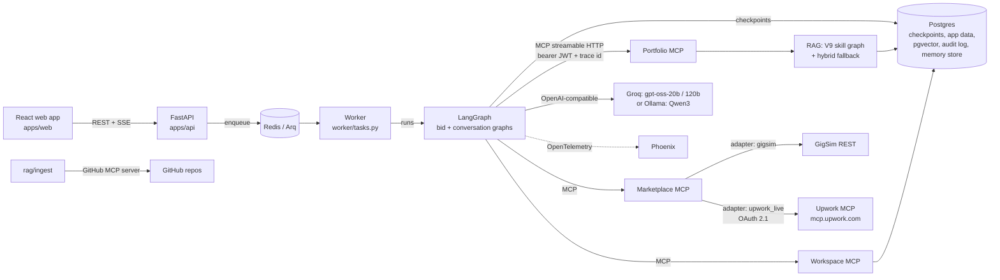

# GigBid architecture

GigBid is a team of agents that turns a freelancer's job feed into grounded, approved proposals. The marketplace is
reached only through MCP; every write (proposal, message, Connects spend) needs a human approval token.

## System

## Bid graph (one thread per job)

* `intake` loads the job through the marketplace port and screens it for injected instructions (quarantine).
* `analyst`, `risk`, `matcher` run in **parallel** (LangGraph `Send` fan-out); their outputs merge through reducers.
* `decide` is a deterministic rule over evidence-based scores (thresholds in `agent/config.yaml`), so a job post
  cannot argue its way to BID.
* `writer -> verifier -> critic` loops at most `budgets.max_critic_revisions` times. The verifier removes unsupported
  claims before the critic sees the draft.
* `compliance` enforces the policy pack, then `preview` saves a marketplace draft and runs a dry-run submit; `approval`
  is a LangGraph `interrupt()`; `submit` reuses the preview's idempotency key, so a crash or replay never resubmits.
* failures after retries and fallbacks go to `dead_letter`; exhausted step/token budgets go to `needs_attention`.

## Conversation graph (one thread per client conversation)

## Agents and hand-offs

| Agent (node) | Model tier | Tools (allowlist) | Output contract |
|---|---|---|---|
| Scout (worker `scout`) | - | search_jobs, get_job | jobs table rows, dedup key |
| Job Analyst | small | - | `JobSpec` |
| Risk Assessor | small + rules | get_client_history | `RiskReport` |
| Fit Matcher | cross-encoder | match_requirements, search_evidence, list_skills | `FitReport` + evidence |
| Pricing Strategist | deterministic | get_market_stats, get_connects_balance, get_policy | `PriceQuote` |
| Proposal Writer | strong | search_evidence, get_case_study | `ProposalDraft` |
| Verifier | cross-encoder + small judge | search_evidence | claims with verdicts |
| Critic | strong | - | `Critique` |
| Compliance Guard | rules + small | - | `ComplianceVerdict` |
| Submitter | - | create_proposal_draft, submit_proposal | `SubmissionResult` |
| Client Liaison | strong / small (intent) | list_messages, send_message, free_slots, create_interview_hold, search_evidence | `IntentResult`, `ReplyDraft` |

All contracts are Pydantic models in `agent/handoffs.py`.

## State, trace and memory are separate

* **State** (`agent/state.py`): typed `BidState` / `ConversationState`, checkpointed in Postgres.
* **Execution trace**: every node writes a trace record (ms, tokens, USD, LLM calls); the worker mirrors node and tool
  events to `run_events` (live SSE stream + run viewer) and spans go to Phoenix through OpenTelemetry.
* **Long-term memory**: the LangGraph Postgres store, written only by `agent/memory/promotion_rules.py`
  (style rules from repeated edits; outcome stats once a category has enough resolved proposals).

## Deployment shapes

* `docker compose up`: separate containers for API, worker, GigSim, the three MCP servers, Postgres+pgvector,
  Redis, Phoenix (and Ollama with `--profile local`).
* Render free tier: one container in all-in-one mode (`GIGBID_ALLINONE=1`) mounts GigSim at `/gigsim`, the MCP servers
  at `/mcp/<name>/mcp` and runs the Arq worker as a background task, with Render Postgres and Key Value.
  See ADR 0004.
