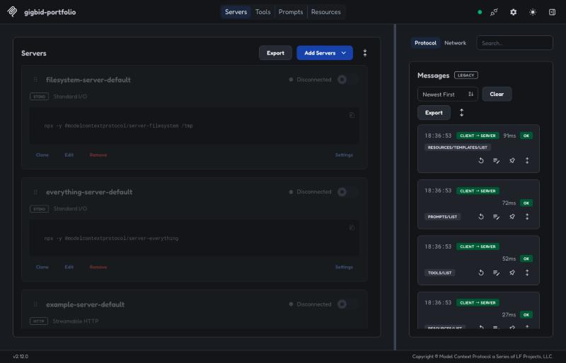
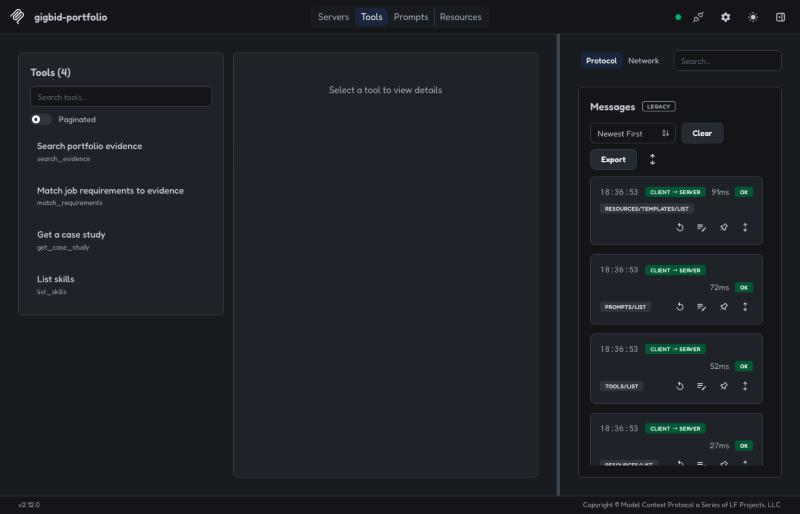
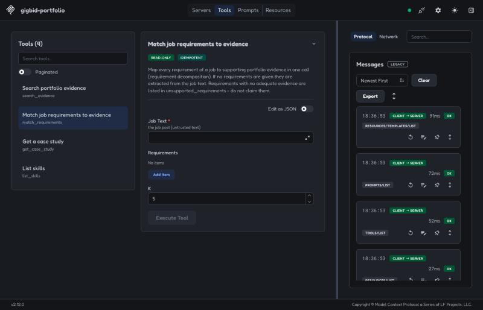
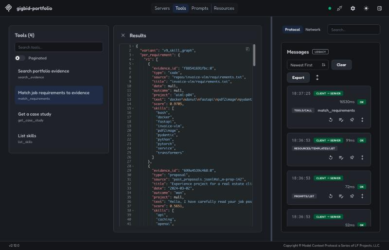
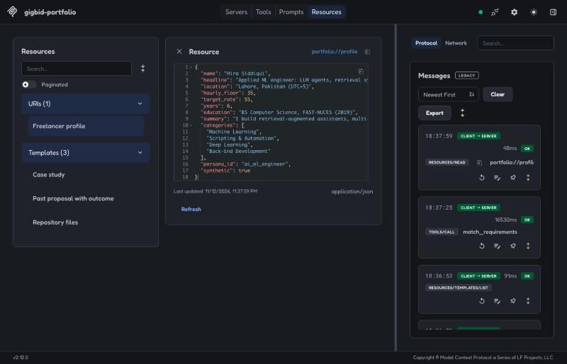
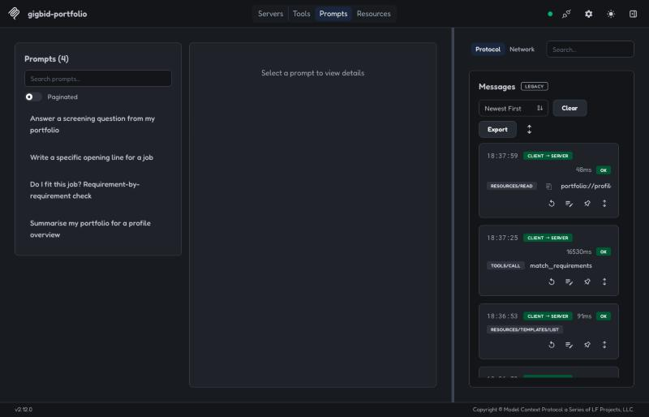

# gigbid-portfolio-mcp

An MCP server that turns a freelancer's portfolio - CV (PDF), case studies (Markdown), repositories (READMEs and
code), client reviews and past proposals with their outcomes - into evidence an agent can search and cite.

It is the Portfolio server of [GigBid](https://github.com/Talha-Qamar/Agentic-A2), published on its own so any MCP
client (Claude Desktop, Cursor, VS Code, your own agent) can use it on any portfolio folder.

## Install and run

No install step is needed with [uv](https://docs.astral.sh/uv/):

```bash
# stdio (for desktop MCP clients)
uvx --from "git+https://github.com/Talha-Qamar/Agentic-A2#subdirectory=mcp_servers/portfolio" \
    gigbid-portfolio-mcp --portfolio-dir ~/my-portfolio

# streamable HTTP on :8201 (endpoint /mcp); set PORTFOLIO_MCP_TOKEN to require "Authorization: Bearer <token>"
uvx --from "git+https://github.com/Talha-Qamar/Agentic-A2#subdirectory=mcp_servers/portfolio" \
    gigbid-portfolio-mcp --transport http --port 8201 --portfolio-dir ~/my-portfolio
```

Optional dense retrieval (fastembed, CPU): add `--with fastembed --with numpy` to the `uvx` command, or install the
`dense` extra. Without it the server uses BM25 with a code-aware tokenizer.

Docker:

```bash
docker build -t gigbid-portfolio-mcp mcp_servers/portfolio
docker run --rm -i -v ~/my-portfolio:/portfolio gigbid-portfolio-mcp                    # stdio
docker run --rm -p 8201:8201 -v ~/my-portfolio:/portfolio gigbid-portfolio-mcp --transport http
```

Try it on the synthetic sample portfolio that ships with the repo:

```bash
git clone https://github.com/Talha-Qamar/Agentic-A2 && cd Agentic-A2
uvx --from ./mcp_servers/portfolio gigbid-portfolio-mcp --portfolio-dir data/personas/ai_ml_engineer
```

## Claude Desktop / any MCP client config

```json
{
  "mcpServers": {
    "portfolio": {
      "command": "uvx",
      "args": ["--from", "git+https://github.com/Talha-Qamar/Agentic-A2#subdirectory=mcp_servers/portfolio",
               "gigbid-portfolio-mcp", "--portfolio-dir", "/absolute/path/to/my-portfolio"]
    }
  }
}
```

## Portfolio folder layout

```
my-portfolio/
  cv.pdf                    # optional
  profile.json              # optional: name, headline, rates
  case_studies/*.md         # optional YAML front matter: project, client_industry, date, repo
  repos/<name>/README.md    # plus code files (.py .ts .tsx .js .sql .yml .toml)
  reviews.json              # [{"project": ..., "rating": 5, "text": ...}]
  past_proposals.jsonl      # {"proposal_id", "job_title", "text", "outcome": won|replied|ignored, ...}
```

Every chunk carries metadata: persona, type, project, skills, date, client industry and, for proposals, outcome.

## Tools

| tool | what it returns |
|---|---|
| `search_evidence(requirement, k, filters)` | evidence items for one requirement; filters by type, outcome, date, project |
| `match_requirements(job_text, requirements, k)` | per-requirement evidence for a whole job post + the requirements nothing supports |
| `get_case_study(id)` | one case study with its metadata |
| `list_skills()` | skills found across the portfolio, with counts and an example item |

All tools are read-only (`readOnlyHint`, `idempotentHint`) and return typed, schema-validated output.

Resources: `portfolio://case/{id}`, `portfolio://proposal/{id}`, `portfolio://repo/{name}`, `portfolio://profile`.
Prompts: answer a screening question, write a specific opening line, requirement-by-requirement fit check,
summarise the portfolio.

## MCP Inspector

Checked with the official MCP Inspector (v2.12.0) over streamable HTTP
(`python -m mcp_servers.portfolio.server --transport http --port 8301`, then add `http://127.0.0.1:8301/mcp`):

| | |
|---|---|
|  |  |
| connected; list calls succeed | the four tools |
|  |  |
| `match_requirements`: read-only + idempotent annotations, typed input | a real call: per-requirement evidence (V9 skill graph) |
|  |  |
| `portfolio://profile` resource | the four prompts |

The same surface is pinned by `tests/contract/test_mcp_schemas.py` (schema snapshot) and exercised through an in-memory
client in `mcp_servers/portfolio/tests/test_standalone.py`.

## Security

The server only reads the folder you point it at. Repository and proposal text is returned as data; clients should
treat it as untrusted. Over HTTP, set `PORTFOLIO_MCP_TOKEN` (inside GigBid each request carries a short-lived per-user
JWT instead, and the portfolio is selected from its claims).

## Licence

MIT. The sample personas in the GigBid repository are synthetic.
